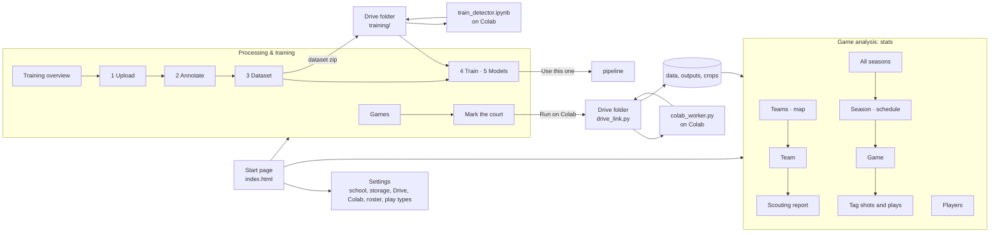

# basketball-tracker

Turns a basketball game video into coaching information: which players were
in the picture, which team they are on, their jersey numbers, where they were
on the court, and per-player numbers such as distance covered.
It is built to run on an ordinary laptop with no GPU (AMD Ryzen 5 4500U, 8 GB
RAM, WSL Ubuntu), so every design choice trades accuracy against CPU time.

**Status: stage 1 ("see the players") is written and works on a 20-second test
clip. It has not been run on a full game yet.** The ball is not tracked
reliably, so nothing about the ball is worked out automatically (no
possession, no passes). Shots are tagged and possessions labelled by hand by
the coach, and everything is done from a dashboard in the web browser with
two areas: **Game analysis** (seasons, teams, games, players) and **Model
training** (teaching the detector on the team's own games). See "The
dashboard".

Roadmap:

1. See the players: tracking, teams, jersey numbers, court positions, stats. **This is what exists.**
2. See the ball and events. **The training of a better detector exists (Model training); automatic shots and possessions do not.**
3. Store games and learn from corrections. **Seasons, teams, tagged shots and labelled possessions exist; learning from corrections does not.**
4. Training suggestions.

---

## How it fits together


The video and every result stay on this laptop, in a data folder outside the
project (see "What is in the repo"). `roster.json` stays in
the project folder on this computer and is ignored by git. Only the code and
this description are in git.

The dashboard (see "The dashboard" below, which has its own diagram) is a
front end to all of this: it starts the same programs and shows the same
files, so nothing has to be typed.

---

## The pipeline

One command runs six stages in this order. Each stage is also a script that
can be run on its own with `--video`.

| Stage | File | What it does | Main result |
|---|---|---|---|
| `detect` | `src/detect_track.py` | Finds players, referees and the hoop in every 3rd frame and follows each person with an ID number | `tracks.json`, `tracked.mp4` |
| `court` | `src/court_mapper.py` | Works out where the court is in every frame, from the landmarks you clicked | `court_frames.json` |
| `teams` | `src/team_assigner.py` | Splits the player IDs into two teams by jersey colour | `teams.json` |
| `jerseys` | `src/jersey_id.py` | Reads jersey numbers and lets the readings vote | `jerseys.json` |
| `tactical` | `src/tactical_view.py` | Player positions in court feet, and a top-down video | `positions.json`, `tactical.mp4` |
| `stats` | `src/stats.py` | Per-player and per-team numbers | `stats.json`, `stats.csv` |

The court stage needs you to mark the court once per video, with three small
browser pages: `src/select_court.py`, `src/select_court_keypoints.py` and
`src/select_hoops.py` (see "Mark the court" below). Shared pieces are in
`src/config.py` (paths and constants), `src/court_model.py` (the court's lines
in feet) and `src/click_tools.py` (helpers for the pages).

---

## The dashboard

Everything in this README can be done in the web browser, with no commands to
type. The dashboard is served by the laptop to the laptop only (address
`127.0.0.1`); nothing is uploaded and nothing is fetched from the internet
except the two fonts (when the laptop is offline, the system fonts are used).

**Start it** in one of two ways:

- Double-click **Hoops Tracker** on the Windows desktop. A black window opens;
  it starts the dashboard and opens the browser at `http://127.0.0.1:7860`. Keep that window open. Closing it
  stops the dashboard, and with it a game that is being processed (nothing
  saved is lost: start again and press the same button to carry on).
- Or type these three lines in the Ubuntu terminal:

  ```bash
  cd ~/aicloudops/basketball-tracker
  source ~/venvs/hoops-tracker/bin/activate
  python src/dashboard.py
  ```

  It prints "Hoops Tracker is running. Open this address in your web
  browser: http://127.0.0.1:7860". Open that address. Ctrl+C stops it.
  `--port 7870` serves at another address; `--open-browser` opens the
  Windows browser by itself.

The shortcut is a `.bat` file, which is not allowed in git, so its text is
kept in `src/dashboard.py`. If the shortcut is missing, or after moving the
project (the shortcut holds this laptop's folder names), write it to the
desktop again:

```bash
cd ~/aicloudops/basketball-tracker
source ~/venvs/hoops-tracker/bin/activate
python src/dashboard.py --make-shortcut
```

### Two areas, one start page

The start page (`index.html`) is the one door between two separate
applications. **Game analysis** is for coaching and shows stats only: the
season and its schedule, the teams and the players, in the look of a video
platform (dark header, white cards, red accent). **Processing & training** is
for the tool itself: getting a game processed (add the video, mark the court,
send it to Colab) and teaching the detector to find the ball, the referees
and the players in the team's own gyms, in the look of a labelling tool
(charcoal sidebar: the Games screen, then five numbered training steps,
yellow accent). Inside either area the header or sidebar has "← Start page" and no
link to the other area; the Settings cog on the start page opens Settings.



### Game analysis

The header is the same on every screen: the school logo, **Seasons · Teams ·
Games · Players**, a search box and "← Start page". The game, season or team a
screen is about is in the address (`game.html?game=game1`,
`season.html?season=2026-27`, `team.html?team=riverside`), so a link can be
kept or shared between the screens.

| Screen | What it is for |
|---|---|
| Season (`season.html`) | **The first screen of Game analysis**: the current season, with a dropdown to switch to an earlier one (or to "All seasons"). The five tiles (Record, Points per game, Allowed per game, Field goals, Threes), **Points by game** (us in red, the opponents in grey; a hollow dot is the points from the tagged shots standing in for a final score that has not been typed), the **season shot map** with the share of points from the paint, threes and free throws, the **schedule** (every game of the season in date order: date and tip-off, home or away, the opponent, the result, and the video's state when one is linked; a video that is on no scheduled game is listed too), the leaders. "Add a game" puts a game on the schedule: date, tip-off, opponent, home or away, kind, the score, and a video to link if there is one already; Edit on a row changes the same things or takes the game off the schedule. "Roster": jersey number and name per player of this season. A season that is not the current one can be made current |
| Seasons (`seasons.html`) | "All seasons": one card per season (the record, games, points per game, a small line of the points by game, the last game); "New season" (name, first day, make it the current one, the roster); an "Unassigned" card when videos are in no season; the eight most recent games with their state. A season that is not current can be deleted here (its games become Unassigned) |
| Games (`games.html`) | **In the processing area.** Every video in the clips folder, grouped by season: Date, Opponent, Result, a status chip, and what to do next: **Mark court** (until the court is marked), **Run on Colab** (the video and the court files go to the Drive folder; the confirmation says whether the court is marked), **Open** (results exist), **Progress** (a run is going), **Redo the stats** (after a roster change: seconds, on the laptop), Edit; **Import now** while Colab is done and the results have not come back yet. "Open Colab" at the top opens the processing notebook; a note on the screen gives the four steps of the flow. The box at the top filters the rows |
| Players (`players.html`) | Season totals for every player on the roster: points and shots from the tagged shots, time on camera and distance from the processed games. Click a player for his season shot map, points by area and a game-by-game table |
| Teams (`teams.html`) | **Where they are**: a map (OpenStreetMap through Leaflet; the one part of Game analysis that needs the internet) with home as a star and each opponent as a dot in its colour, a popup with the record against them and a link to the team. Then a card per opponent (Opponents: this season's; All seasons: everyone; Our team: one card per season for our own side) with the record against them over the schedules, their record as typed, where they are, main defense and offense, whether they press, points per game, the defense mix; "Add a team"; the compare table (share of possessions by offense type, points per possession) |
| Team (`team.html`) | One opponent. **About them**: where they are, their record and points as typed or pasted, coach, level, the links to their pages (MaxPreps, the school site...) that open in a new tab, their roster, and when it was typed; **Edit** opens the form ("Find on the map" asks OpenStreetMap for the place typed; a pasted roster page is read line by line for the numbers and names). **Head to head**: the record, points for and against and the upcoming games over every season's schedule, videos or not. Then what they run on offense, how they defend us, where they score (their tagged shots), their players by jersey number with the coach's notes, the games against them on video, the scouting report (PDF) |
| Game (`game.html`) | One game the way a video platform shows it. The **video** (the game file itself; the tool's check video `tracked.mp4`, which carries tracking IDs and the pipeline's "ball?" guesses, stands in only when the browser cannot play the game file) with the **possession timeline** under it: one block per labelled possession (red ours, grey theirs scored, pale a turnover; the tagged shots as dots when nothing is labelled yet), Q1–Q4 as equal parts of the video, "Only made shots" and "Only presses" play those clips one after another; a link such as `game.html?game=game1&playlist=fast-break` starts a playlist. The **live court** follows the video, one dot per player from `positions.json` (a moment with no position for anyone is a gap in that file, feet out of the picture or no court mapping there, and the panel under the court says so); click a dot to follow one player (speed now, nearest defender, sprints, distance). The tiles (points tagged, field goals, threes, free throws, turnovers), the **players table** (a number plays that player's shots), the **scoring heat map** (team or one shooter). The line under the title holds the small links that set the final score, "we wear" (which jersey colour group is us) and, for a game with no opponent yet, "Name the opponent". Below: the processing card while a run is going, and the **Court set-up** panel with the three click pages (with **Run on Colab** for a game that is on Colab, to send the court files) |
| Tag shots and plays (`tag.html`) | **Shots**: play the video, pause at a shot, every tracked player gets a box; click the shooter (or type the team and number), 2 or 3 points or free throw is worked out from the position and can be changed, press MADE or MISSED. The list of shots, "Undo last", click a shot to change or delete it. **Plays**: "Add possession", Start and End take the video's time (keys S and E; Space plays and pauses), who had the ball, the offense run and the defense faced (the play types from Settings, editable in place), scored / missed / turnover, points (counted from the tagged shots unless typed), a note. See "Shots and the scoring heat map" |
| Settings (`settings.html`) | School (name, team name, drop a new logo), Storage, **Google Drive** (the Drive folder on this computer, "Check the folder", what is in it, delete each video from Drive once its results are back), **Colab** (the training notebook to download, the last word from the Colab worker), Processing (court size, run new games on this laptop or Colab, the **detector model in use**, make the videos), the **Roster** of the current season, the **Play types** (one per line, offense and defense), About ("Check everything" looks at every file and program the tool needs) |

**A new game, from start to finish:**

1. Copy the video file into the `clips` folder with Windows Explorer ("Add a
   game" on the Season or Games screen shows the folder as a
   `\\wsl.localhost\...` path that Explorer opens). A video may also be a link
   in `clips/` to a file kept elsewhere on the laptop.
2. "Add a game": choose the video, the season, name the opponent (a new name
   makes a team on the Teams screen), home or away, the date; the final score
   can be typed now or later.
3. Fill in the roster (Settings, or "Roster" on the season) if you have the
   numbers and names, best before step 4.
4. **Mark court** on the game's row: the Court set-up panel at the bottom of
   the Game screen opens the three click pages (about ten minutes).
5. **Run on Colab** on the row (or "Send to Colab" on the Game screen): the
   video and the court files go into the Drive folder, and Colab does every
   step, 3 to 4 hours for a full game (see "Running a game on Colab"). Then
   **Open Colab** (the button at the top of the Games screen) and press Run
   all there. A game sent before its court is marked stops at the court step
   and waits; marking it and pressing Run on Colab again finishes it.
6. The results come back by themselves while the dashboard is open.
7. Open the game, tag the shots and label the possessions ("Tag shots and
   plays"). The season, the players and the opponent's team page fill
   themselves from that.

Good to know:

- **The laptop does not process games any more.** `python src/main.py` still
  works from a terminal (a day or two per game), and a run started that way
  can be watched on the Games screen; the only job the screens still run on
  the laptop is "Redo the stats", after a roster change, in seconds.
- **The browser page can be closed** while a game is processed; the work goes
  on, and the page finds it again. The black window (or the terminal the
  dashboard was started in) must stay open.
- **The click pages get their own address.** A click page takes the first
  free port from 7860 upward (normally 7861); it opens in a new browser tab
  and the Court set-up panel shows the link too. One click page at a time;
  its clicks are saved only by its own "Save and close".
- **Names come from the season's roster.** Every screen shows a name only for
  a player whose team and number were read. The pipeline's jersey reader and
  `stats.csv` still read `roster.json` in the project folder (see "Player
  names"); the first time the dashboard starts it copies that file's names
  into the current season.
- **If a data folder cannot be reached** when the dashboard starts, every
  screen shows one page that says which folder, where its link points and
  what to do; it works again as soon as the folder is back.
- **What the browser can be shown.** Files under `outputs/`, `crops/`,
  `clips/`, `data/` and the branding folder, at `/files/<folder>/...`.
  Nothing from the home folder, the code or `models/`. Only a browser on this
  laptop can ask.
- **Some settings are stored, not yet acted on.** The court size is kept, but
  the first click page still asks for it; "Make the videos" is kept, but
  `main.py` has no option to skip the videos yet.
- **Provisional numbers are labelled.** A game whose court was marked with
  stand-in clicks (the test clip) says so on every screen that uses positions:
  positions, 2-or-3, shot maps, distances and sprints are provisional until
  the court is marked by hand.

### Seasons, teams and games: the data model, in plain words

Everything the coach types lives in small JSON files in the data folder,
never in git. `src/library.py` reads and writes them and works out every
number the screens share (`python src/library.py` lists the seasons, the
teams and every game; `--season 2026-27`, `--team <id>` and `--game <video>`
print what a screen gets).

| File | What it holds |
|---|---|
| `data/_library/seasons.json` | The seasons: name, first day, which one is current (exactly one), each season's **roster** (our team's name, jersey number and name per player; names are kept here only) and its **schedule**: every game of the season with date, tip-off, opponent, home or away, kind (league, non-league, tournament), the final score, and the video linked to it once there is one. A linked video and its scheduled game keep the same date, opponent, home and score whichever of the two the coach edits |
| `data/_library/teams.json` | The opponents: name, a short code, a colour, the coach's notes per jersey number ("Goes left"), where they are (a place and, once looked up, its map position), links to their pages, what the coach typed or pasted about them (record, points for and against, coach, level, the source and the day) and their roster by number. Also "home": where our own gym is, for the map. Our own team is not a row |
| `data/<video>/game_info.json` | What the coach said about one game: its season, the opponent, the date, home or away, which detected colour group is us, the final score, where it was processed (laptop or Colab), the gym's conditions |
| `data/<video>/shots.json`, `possessions.json` | The shots tagged and the possessions labelled by hand (see "Shots and the scoring heat map") |
| `data/_library/gyms.json` | The gym library: the courts the team plays on, each with its size and markings (length, width, lane width, free-throw and three-point distances), measured from the coach's clicks on the landmark page or typed; the first click page offers them for the next video |
| `data/_dashboard/play_types.json` | The offense and defense play types a possession can be labelled with; edited on Settings or in place on the Plays screen |
| `data/_dashboard/settings.json` | The settings, among them the Drive folder path and the detector model in use |
| `data/_dashboard/drive.json` | What this laptop remembers about the games sent to Colab |
| `data/_dashboard/` | Also: the game chosen last, the lengths of the videos, what background jobs printed (`logs/`), and the branding folder. A folder in `data/` whose name starts with `_` is never a game |

Where the numbers come from: the record and the points per game from the
scores on the schedule and the games (the tagged points stand in, and are
marked as such, until a score is typed); FG%, threes, the shot maps and the leaders from the
tagged shots; time on camera and distance from `stats.json` (never "minutes
played": the camera follows the play); what a team runs from the labelled
possessions; a game with no season is listed under "Unassigned".

### Model training

The detector that finds players, referees, the hoop and the ball can be
trained on the team's own games, in five numbered steps (the sidebar):

| Step | Screen | What it does |
|---|---|---|
| Overview | `train.html` | The project line (four classes: Ball, Referee, Player, Hoop), the five-step strip with live counts, **dataset health** (labels per class, pictures by condition: good light, dim gym, zoomed out, blurred; "need more" under 150), the next steps |
| 1 · Upload | `upload.html` | Pictures come from the game videos in the clips folder, processed or not. Tick the games, say how many pictures each (150 by default); the tool spreads them over the whole video by seeking, works out each picture's conditions (dim, blurred, zoomed out) and, with **label assist** on, runs the detector in use to draw first boxes. One game can be kept for testing. The job shows progress and time left |
| 2 · Annotate | `annotate.html` | The box editor (it can be used while the Upload job is still running label assist: the two never write over each other, an answer saved here is kept): **hard pictures first** (the model was unsure, dim, blurred, small ball), in order, or only unsure. Boxes in class colours, dashed when the model was unsure; drag to move, corners to resize, Delete, draw a new box with B, 1–4 choose the class, a 3× zoom inset follows the pointer. "Looks right · next" (Space), "No ball here" (N), "Can't tell" (S), Undo (Z); a filmstrip of the neighbours. Keys are listed on the buttons |
| 3 · Dataset | `dataset.html` | Checked pictures become a numbered **version**: train / check / test split (a whole game kept back for the test when there is more than one game; otherwise stretches of the same game, and the page says this is a weaker test), the variations for bad conditions (darker and brighter, motion blur, zoomed out, slight tilt, mirror, colour shift), "Build version N" with progress, the versions table with "Download zip" |
| 4 · Train · 5 · Models | `models.html` | "1 · Send dataset to Drive" copies the version's zip (and the model to start from) into the Drive folder; "2 · Open Colab and train" opens the notebook; the Colab line says what the notebook last reported; "3 · Bring back" copies a finished model into `models/`. The **score by version** chart and the **models table** (per class, in a dim gym, speed on this laptop; the downloaded models are named in plain words, "Player finder" and "Ball finder", with the file name as the tooltip, and the small general model is listed only while it is the one in use), "Use this one" (the pipeline uses that model from the next run on), "Try on a clip" (runs the model over the test clip and measures frames per second), "Where it still struggles" |

The Overview has no "New project" button, although the design had one: a new project would throw away every box the coach has drawn, so starting over is done by hand (move the `data/_training` folder away). See "Training the detector" below for the files and what was tested.

**Coming next** (not built yet): shots and
possessions found by the tool instead of tagged by hand; a model that finds
the ball reliably (the first job of Model training); a clip model trained
from the tagged shots (the Annotate screen only counts them so far);
training the referee's signals.

**School branding.** The start page and the header show the school logo, the
school's name and a piece of artwork. All of that is read while the program
runs from the branding folder, `data/_dashboard/branding/`: a
`branding.json` (`school_name`, `mascot`, `logo`, `hero`) and the two picture
files it names. That folder is not in git, and nothing in the code or in this
README says which school it is. Without the folder the dashboard works the
same and shows the neutral title "Hoops Tracker" and a plain drawn ball.

### How the dashboard is put together

A small FastAPI server (`src/dashboard.py`, run by uvicorn; both came with the
earlier Gradio install, so nothing new is installed) serves the pages in
`web/` as they are (plain HTML, CSS and JavaScript, no build step, no
framework, no scripts from the internet) and answers their JSON requests
under `/api/...`. Each screen is one `.html` and one `.js` file; one API
module serves each group of screens, and the logic they share has no web code
in it, so the pieces can be read one at a time. The look of both areas is in
one stylesheet, `web/app.css`, taken from the approved design.

| File | What it is |
|---|---|
| `src/dashboard.py` | The server: the pages, `/files/...`, the guard that answers only this laptop's own pages (see "Keeping it safe"), the shortcut, the "data folder not found" page, starting and stopping. It includes `dash_api.py`, `api_settings.py` and each screen module below if its file exists |
| `src/dash_common.py` | What the API modules share: the list of games with the state of each stage, settings, branding, storage, and the background jobs (processing, the click pages, picking pictures, the speed test; their logs in `data/_dashboard/logs/`) |
| `src/dash_api.py` | The shared routes (games, seasons, teams, play types, settings, jobs, branding); its docstring is the contract the screens follow |
| `src/library.py` | The data model above and every number the screens share |
| `src/api_seasons.py` | Seasons, Season, Games and Players |
| `src/api_teams.py` | Teams, Team and the scouting report |
| `src/api_game.py` | The Game screen: the summary, the positions table the live court follows, the court set-up |
| `src/api_tag.py` | Tag shots and plays, with the logic in `src/shots.py` (shots, points, 2 or 3) and `src/possessions.py` (possessions, what a team runs) |
| `src/api_training.py` | Overview, Upload and Annotate, with the logic in `src/training_data.py` (pictures, boxes, conditions, label assist) |
| `src/api_models.py` | Dataset, Train and Models, with the logic in `src/training_versions.py` (versions, the zip, the speed test) |
| `src/api_drive.py` | The Google Drive link, with the logic in `src/drive_link.py` |
| `src/api_settings.py` | The Settings screen's own routes (school, logo, "Check everything", the notebook) |
| `web/app.css`, `web/app.js` | The shared look and the shared JavaScript: fetching, the header and the sidebar, messages, the half-court drawing, formatting, watching a job |
| `web/game_rows.js` | A game's row with its status and buttons, "Mark court", "Run on Colab", "Redo the stats" and the "Add a game" panel, shared by the Season and Games screens |
| `web/team_parts.js` | The tables of the Team screen, shared with the scouting report |
| `web/*.html` and `.js` | The screens: `index`, `seasons`, `season`, `games`, `players`, `teams`, `team`, `report`, `game`, `tag`, `settings`; `train`, `upload`, `annotate`, `dataset`, `models` |

What was tested, and what was not:

- Every screen was opened on the test clip at three screen widths (1440,
  1280 and a phone's 390) in a headless browser driven by a program, with no
  errors in the browser's console, and the links between the screens were
  followed (the 390 check was repeated after the last round of fixes: no
  screen is wider than the phone). Each screen was compared by eye with its
  design. At 1280 by 720 the start page's footer and the Game screen's
  timeline stay in view, and the models table fits without scrolling; a
  table that is still wider than its card (the Players screen's game-by-game
  table) has a scrollbar drawn under it.
- The flows were walked by that program, with real mouse clicks and through
  the API, on a scratch copy of the data so that nothing invented reaches the
  real folders: a new season, the test clip put in a season with an opponent
  and a final score, shots tagged and possessions labelled, the Game, Team
  and scouting report screens filled from them, ten training pictures picked
  with label assist, pictures checked in the box editor, a dataset version
  built, "Try on a clip" with the downloaded model, the game sent to a
  stand-in Drive folder and results brought back from a simulated Colab.
- **No person has used it yet**, no full game has been processed from it, and
  nothing has been run on Colab. The times it quotes for a full game are the
  estimates under "Limitations", scaled by the length of the video.

---

## Run it

Everything the dashboard does can also be done from the Ubuntu terminal.

```bash
cd ~/aicloudops/basketball-tracker
source ~/venvs/hoops-tracker/bin/activate
python src/main.py --video clips/test.mp4
```

- A stage is skipped when its results are already there and are newer than
  the files they were made from. After any stop (Ctrl+C, a crash, the laptop
  shutting down) run the same command again: finished stages are skipped and
  a half-done detection, jersey reading or court mapping carries on where it
  stopped.
- `--force` does every stage again. `--from teams` does that stage again
  (stage names as in the table above), and then every later stage that uses
  its results: after `teams` that is `tactical` and `stats`, but not the hours
  of jersey reading. If such a run is stopped, run it again without the option
  to carry on.
- Detection of a video that is already finished is never started again by
  accident: it takes `--force` or `--from detect`. `tracks.json` and
  `tracked.mp4` are only written when the end of the video is reached, so
  stopping a run early cannot replace finished results.
- If the court has not been marked for the video, detection, teams and jersey
  numbers run first. Then the program stops and prints the commands to run.
  You can also mark the court in a second terminal while detection is running.
- At the end it prints where the results are (also as Windows paths, such as
  `\\wsl.localhost\Ubuntu\home\...`), any stretches of the game with no court mapping, the
  stats table and any warnings.
- Everything it prints is also added to `data/<video>/run_log.txt`, so the
  summaries of a long run can still be read after the terminal has scrolled
  on or been closed.
- Keep the laptop awake and VS Code open during a long run. If WSL shuts
  down, the run stops; nothing saved is lost, and the same command continues it.
- Run one video at a time; the laptop does not have the memory for two. A
  second run on the same video is refused while the first is still going.

### If a data folder cannot be reached

`clips`, `models`, `data`, `outputs` and `crops` in the project are links
(`ls -l` shows where each points; today that is `~/hoops-data/<name>` on the
laptop's own disk). When a message says a folder cannot be reached, the
folder a link points to is missing: it was moved or renamed, or it is on a
removable drive that is not plugged in. Put it back, or make the links again
as under "Reinstall from scratch".

Data on a removable Windows drive (the SD card the project used until it
failed) has to be attached to Ubuntu first, with `sudo mount -t drvfs D:
/mnt/d`; `chkdsk D: /f` in a Windows administrator Command Prompt repairs a
damaged folder index on such a drive.

If a message says a file is damaged, or a video "could only be read up to"
some point, the file has been spoiled. Delete a damaged data file and run
`main.py` again; copy a damaged video to the clips folder again and run
`main.py` with `--force`.

### Mark the court (once per video)

The camera view moves, so the tool needs to know where the court is. Steps 1
to 3 need no player detection, so they can be done before or during the long
detection run. In the dashboard, the Court set-up panel at the bottom of the
Game screen starts these pages.
From the terminal, each command prints an address like
`http://127.0.0.1:7860`; open it in the browser. The pages run only on this
computer.

To do this while detection is running, open a second terminal (in VS Code:
menu Terminal, New Terminal) and switch the environment on there first:

```bash
cd ~/aicloudops/basketball-tracker
source ~/venvs/hoops-tracker/bin/activate
```

1. `python src/select_court.py --video clips/game1.mp4`
   Choose the court size (high school 84 x 50 ft is the default; type your own
   numbers for another court, or pick a gym measured before from the gym
   list). Untick any reference picture that is blurred or does not show the
   court. Press "Save and close".
2. `python src/select_court_keypoints.py --video clips/game1.mp4`
   Pick a picture, choose a landmark from the list, click it in the picture,
   then click it again exactly in the enlarged picture. Use the basketball
   lines, not the lines of other sports. Do at least 4 landmarks at each end
   of the court the video shows, 10 to 14 in total, and include the two
   points where the half-court line crosses the centre circle. After 4 landmarks a green
   court is drawn: it should sit on the real lines in every picture. **If every
   click is a foot or two off in the same way, the gym is not the size you
   chose**: press "Measure the court from my clicks" (it needs 4+ landmarks at
   each end and a centre point) and the tool tries the sizes and markings a
   court can have (length, width, lane width, free-throw and three-point
   distances) and says which fits the clicks best and by how much; "Use the
   measured size" keeps it, and "Save this court as a gym" puts it in the gym
   library for the next video from that gym. Press "Save and close".
3. `python src/select_hoops.py --video clips/game1.mp4` (optional for now;
   it is for shot detection later.) For each hoop, click the two ends of the rim.
4. Run `python src/main.py --video clips/game1.mp4` (again; if it is still
   running in the first terminal there is nothing to do, it goes on to the
   court stage by itself). After the court stage, open
   `outputs/game1/court_check.jpg`: the green court should sit on the real
   lines in all the small pictures. If the summary lists stretches with no
   court mapping (it is repeated at the very end of the run and kept in
   `run_log.txt`), add a reference picture with the command it prints and run
   `main.py` again.

If the camera was moved during the recording, or it is another game, do these
steps again for that video.

### Player names

The dashboard keeps the names in the season's roster (the "Roster" button on
a season, or the Roster section of Settings for the current season): a
jersey number and a name per player. The pipeline's jersey reader and
`stats.csv` still read `roster.json` in the project folder (copy
`roster.example.json` to `roster.json` and fill in jersey number and name for
each team by hand); the first time the dashboard starts it copies that
file's names into the current season. Both files are ignored by git, so
names never leave this computer; everything works without them. The stats
show a name only for a player whose team and number were read, and only when
the numbers read fit one roster team clearly better than the other (the
roster does not say which jersey colour a team wears; "Our team wears" on
the Game screen does). Jersey reading uses `roster.json` too: when both
teams are filled in, a number that is on neither counts as half a vote. So
fill it in before a game is processed. For a game that was read before the
roster was filled in, run `main.py` with `--from jerseys` for that to take
effect: it reads the numbers again, which takes hours for a full game.

---

## Running a game on Colab

The laptop takes a day or two per game. Google Colab lends a graphics card for
free, and the same pipeline runs there in a fraction of the time (not yet
measured: no game has been run on Colab so far). The pieces are
`src/colab_worker.py` (a plain script that works through a Drive folder),
`colab/process_games.ipynb` (the notebook that starts it) and, on the laptop,
`src/drive_link.py` (the dashboard's "Run on Colab" and the way results come
back). On the laptop nothing in this code talks to the internet (the pages' two
fonts, above, and the Teams map, which fetches its tiles from OpenStreetMap and
looks a typed place up there when asked, are the dashboard's only outside contact): Google Drive for
desktop carries the files, and the dashboard only copies them to and from a
folder on this computer. On Colab the notebook fetches the program from GitHub
and its libraries, and the number reader fetches its own two files if Drive's
`models` folder does not hold them.

**Set up once.** Install Google Drive for desktop, make a folder `Hoops
Tracker` in Drive, and on the Settings screen type where that folder is on
this computer (for example `G:\My Drive\Hoops Tracker`); "Check the folder"
confirms it. The dashboard makes `inbox`, `outbox` and `models` inside it as
it needs them and copies `player_detector.pt` into `models` with the first
game. Download `colab/process_games.ipynb` once and keep it in Colab.

**For each game.**

1. **Run on Colab** on the game's row (Season or Games screen). The video is
   copied into `inbox/` (the row shows the copy's progress and time left),
   with the court files when the court has been marked here. Google Drive for
   desktop uploads it.
2. Open the notebook in Colab, choose the T4 GPU under Runtime > Change
   runtime type, and press Runtime > Run all. Allow the Drive connection when
   asked. The last cell runs until it is stopped: it looks in the inbox every
   minute and processes what it finds, printing the same lines `main.py`
   prints on the laptop.
3. The row follows Colab: "Sent to Drive · waiting for Colab", "On Colab ·
   57% · reading the jersey numbers", "Done on Colab · bringing the results
   back". The dashboard looks in `outbox/` every minute and copies a finished
   game's results into `data/`, `outputs/` and `crops/` by itself (or at once
   with "Import now" on the row); the row then says "Finished" (a "Back from
   Colab" chip shows for a moment, until the rows reload). Google
   Drive brings a folder's files in no set order and `status.json` is the
   smallest, so an import counts only once every result file the status
   promises has arrived; until then the row keeps saying "bringing the results
   back" and the dashboard looks again a minute later. A file that is newer on the laptop is kept,
   and the coach's own files (shots, possessions, the game's info) are never
   replaced. With "Delete each video from Drive once its results are back"
   on (Settings), the video is deleted from the inbox after a finished import;
   the outbox is never deleted.
4. `needs_court`: Colab did the long stages without the court. Mark the court
   on the Game screen and press Run on Colab again (on the game's row, or the
   button in the Court set-up panel): only the court files go, and the worker
   finishes the positions and stats the next time it looks. A game Colab
   failed on keeps its Run on Colab button (try again).
5. If Colab goes quiet for 20 minutes while a game is "running", the row says
   so: the notebook has stopped (the tab closed, or the free session ended);
   press Run all again and it carries on where it stopped.

Without the dashboard: `python src/drive_link.py` says whether Drive is
connected and what is in the folder; `--send test`, `--status test`,
`--import test` and `--poll` do the steps above by hand.

What the worker writes, in `outbox/<game>/`: `status.json` (`done`,
`failed`, `needs_court` or `running`, with a progress line while it runs),
`data/` (every result file: `stats.json`, `stats.csv`, `tracks.json`, ...),
`outputs/` (the videos and pictures) and `crops/`. `worker.log` in the
Drive folder has everything that was printed.

**Limits.**

- Nothing happens unless the notebook is running. Closing the tab, or leaving
  it idle for a while, stops the processing; a free session also ends by
  itself after about 12 hours. Nothing is lost: the results so far are copied
  to the outbox every minute, and the next Run all carries on where it
  stopped (finished stages are skipped, a half-done one continues).
- The worker stops by itself after 15 minutes with nothing in the inbox
  (`--idle-minutes`, 0 keeps it waiting), and the notebook then lets go of the
  machine, so a session never burns compute units all night. The times it
  writes are in Colab's clock (UTC); it writes the moment itself beside them,
  and the dashboard shows that in the laptop's clock.
- While the video and the results are in Google Drive they sit in the coach's
  own Google account, under Google's terms. Sending a video there is the
  coach's own button press each time.
- The roster never leaves the laptop, so on Colab the numbers are read
  without it (a number that is on neither team counts as a full vote there)
  and the stats have no names. Pressing "Redo the stats" on the Games screen
  afterwards redoes the stats step with the roster in seconds.
- One game at a time; the games are taken in name order.
- The code takes the graphics card by itself when there is one
  (`HOOPS_DEVICE=auto` is the default; `HOOPS_DEVICE=cpu` forces the CPU).
  On the laptop there is none, so nothing changes there.
- The copy into the Drive folder and the once-a-minute look in the outbox are
  threads inside the dashboard: closing the dashboard mid-copy leaves a
  half file (`<game>.mp4.part`) that the next Run on Colab replaces.

What was tested, and what was not:

- The worker was run on this laptop (CPU) against a stand-in Drive folder on
  the laptop's disk, with the test clip under two new names: one with its
  court files, one without. The first came back `done` after 12 minutes
  with every result file, both videos and the pictures; its `teams.json`,
  `jerseys.json` and `positions.json` are byte-for-byte the same as the
  laptop's own results for the test clip, and `tracks.json`,
  `court_frames.json` and `stats.json` differ only in the video's name, the
  seconds the court stage took and a warning that quotes the name. The
  second came back `needs_court` after 7 minutes with the tracking, teams
  and jersey results; after its court files were put in the inbox, the next
  run skipped the three finished stages and finished it in 45 seconds. A
  run with nothing to do exited in 9 seconds. A run cut short by the laptop
  restarting was picked up by the next one.
- The laptop side was tested against a plain folder standing in for the
  Drive folder, with `status.json` files written by hand for every state:
  the copy with progress, the court files sent, a second send that copies
  nothing, "running" with the percentage and the stage in words, the refusal
  to import while running, the import of a `done` game (results copied,
  newer local files kept, the coach's files untouched, the video deleted
  from the inbox), `needs_court`, `failed`, a stale run, and the dashboard's
  own once-a-minute import.
- **Nothing has been run on Colab, or on a graphics card, and no real Google
  Drive folder has been used** (whether Drive for desktop keeps file times,
  streaming placeholders, sync delays). The notebook's cells, the Drive
  mount, the installs on Colab's Python, the speed on the T4 and whether the
  results on the graphics card equal the CPU's have not been tried. A full
  game has not been run through the worker either.

---

## What comes out

Everything is written to the data folder, in folders named after the video
(`test` for `clips/test.mp4`).

| File | What it is |
|---|---|
| `outputs/<video>/tracked.mp4` | The game with a box and tracking ID on every player and referee |
| `outputs/<video>/tactical.mp4` | The game above a top-down court diagram, one dot per player in team colour with the jersey number |
| `data/<video>/stats.csv` | The per-player table; opens in Excel |
| `data/<video>/stats.json` | The same with every detail, plus team spacing minute by minute |
| `outputs/<video>/position_map_<team>.png` | Position map: where on the court each team's players were seen (where they stood, not where points were scored from) |
| `outputs/<video>/teams_sheet.jpg` | Check by eye: sample pictures of every ID grouped by team |
| `crops/<video>/track_<5-digit ID>.jpg` | Check by eye: what the jersey reader looked at and what it read |
| `outputs/<video>/court_check.jpg` | Check by eye: the green court drawn on 8 moments of the game |
| `outputs/<video>/court_views.jpg`, `court_calibration_check.jpg`, `hoops_check.jpg` | Check by eye: the court set-up |
| `data/<video>/tracks.json` | Every box in every frame looked at (players, referees, hoop, and unreliable ball boxes) |
| `data/<video>/teams.json`, `jerseys.json` | Team and jersey number of each tracking ID, with the votes behind them (the team is empty when it could not be told) |
| `data/<video>/court_setup.json`, `court_calibration.json`, `hoops.json`, `court_views/` | Your court set-up |
| `data/<video>/court_frames.json` | The court mapping of every frame looked at |
| `data/<video>/positions.json` | Every player's position in feet (x from the left baseline as the camera sees it, y from the near sideline) |
| `data/<video>/run_log.txt` | Everything `main.py` printed, run after run |

### Reading the stats

**Nothing here is "minutes played".** The camera follows the play and never
shows the whole court, so a player who is out of the picture is not counted.

| Column | Meaning |
|---|---|
| Seen | Time the player was seen on camera |
| On map | Time the player also had a position on the court (feet inside the picture) |
| Distance | Feet covered while on the map. Gaps are not filled in, and a step that would need more than 25 ft/s is left out as a tracking mistake |
| Speed | Distance divided by the time of the steps that were counted, in feet per second |
| Avg spot | Average position in court feet |
| Left / Mid / Right | Share of the on-map time in each third of the court, as the camera sees it |
| Paint | Share of the on-map time inside either lane |
| IDs (called "Tags" in the dashboard) | How many tracking IDs were joined into this player |

- One real player usually gets several tracking IDs. IDs with the same team
  and the same jersey number are joined into one player.
- An ID without a number is never guessed. It is counted as "unidentified"
  for its team, below the table (the longest few are named by tracking ID, as
  they are labelled in `tactical.mp4`), and has its own row in `stats.csv`
  after the numbered players.
- Spacing is the average distance between a team's players that are on the
  map at the same moment.

---

## Shots and the scoring heat map

The ball cannot be found in the video (see the ball experiment below), so the
tool does **not** detect shots. The coach tags each shot, on the Tag shots
and plays screen of the dashboard, and the tool adds what it already knows
about that moment. The logic is in `src/shots.py` (and `src/possessions.py`
for the plays), the page in `web/tag.html` and `web/tag.js`, its API in
`src/api_tag.py`.

1. Play the video and pause it when a shot is taken (the play button, the
   −5s and +5s buttons, the bar, or the space bar), best just before the
   shooter leaves the floor.
2. As soon as it is paused, every tracked player gets a box drawn over the
   picture, labelled with the jersey number that was read, or with "tag" and
   the tracking ID when no number was read.
3. Click the shooter in the picture. A shooter who has no box can be typed in
   as team and number.
4. Press MADE or MISSED (first choose "Free throw" if it was one). The video
   plays on.

The page plays the game video itself, not `tracked.mp4`: it is smooth (the
tracked video has 10 pictures a second, too few to see a shot go in), and the
tracked video writes a tracking ID above each box that is easily taken for a
jersey number. Only when the browser cannot play the game file (anything but
H.264 in an mp4) is the tracked video shown.

What the tool fills in:

| | Where it comes from |
|---|---|
| The moment | The nearest moment of the video that was looked at (about 10 a second) |
| Team and number | The box that was clicked; both can be corrected by typing |
| Position | `positions.json` for that player at that moment. If he has no position just then, the nearest moment within one second. Otherwise the shot is kept as "position unknown" |
| 2 or 3 points | The position against the three-point line of the nearer hoop. A free throw is 1. The coach can always choose 2 or 3 himself |

The tool does not know which hoop a team shoots at. Every shot is measured to
the **nearer hoop**, which is the right one for any shot from a team's own
front court. An earlier version asked the coach to set the ends for each
period instead; a period left unchanged at half time then turned every
two-pointer of both teams into a three, so that question was taken out. The
"Period" on the screen is only written next to each shot. The one case the
nearer hoop gets wrong is a heave from deep in a team's back court, close to
its own hoop: it is taken for a 2, and the coach chooses "3 points" for it.

For a game whose court was marked with stand-in clicks (the test clip), the
screen says under the video that the positions, the 2 or 3 worked out from
them and the scoring heat map are provisional.

Every shot can be changed or deleted (click it in the "Tagged so far" list),
and "Undo last" takes back the last thing done. The Game screen then
shows, for both teams, and the Season, Players and Team screens add up:

- **The score tiles and the players table**: points, field goals, threes and
  free throws made and tried, from the tagged shots; per player next to the
  stats.
- **The scoring heat map**, per team or per player: where the points came
  from, drawn in the page on one half court. Both ends of the court are
  folded onto that half, drawn as the shooter sees it with the hoop at the
  top, because a team shoots at one end and then the other. A made shot is a
  dot (bigger for a three), a miss is a cross, and a soft disc round every
  made shot builds up where they cluster; the points by area are listed
  beside it. The screens draw the map themselves; `src/shots.py` draws the
  two pictures below from the command line (these add shading only from 20
  made shots on, and write the count on the picture).

In this project "heat map" always means where points were **scored from**.
The pictures of where players **stood** are the position maps.

| File | What it is |
|---|---|
| `data/<video>/shots.json` | The tagged shots. The fields are described at the top of `src/shots.py`. Each shot has a `source` ("coach"), so a later automatic shot detector can write the same file |
| `data/<video>/shots_undo.json` | The file as it was before the last change |
| `outputs/<video>/scoring_heat_map_<team>.png` | The scoring heat map of each team as a picture, drawn by `shots.py` from the command line |
| `data/<video>/possessions.json` | The possessions labelled on the Plays side: start and end, who had the ball, the offense run and the defense faced, the outcome (scored, missed, turnover), the points (counted from the shots inside the span unless typed), a note |

Without the dashboard: `python src/shots.py --video clips/game1.mp4` prints
the shots and the points table and saves the two pictures; `--add`, `--delete`
and `--undo` change the list (`--help` shows how).

**Plays.** On the Plays side of the same screen the coach marks each
possession: when it started and ended (the video's time, or the keys S and
E), who had the ball, the offense run and the defense faced (the play types
from Settings, editable in place), and what came of it. The tool counts the
points from the shots tagged inside that span unless a number is typed. From
these the Team screen works out what an opponent runs (the share of their
possessions per play type, points per possession, FG%, turnovers), how they
defend us, how often they press after a made basket and what came of it. The
Game screen draws the possessions as the clickable timeline under the video.
Recognising possessions automatically is a later stage.

Limits:

- **Only what was tagged.** A shot the coach did not tag does not exist for
  the tool, and nothing is checked against the scoreboard.
- **A position is an estimate** (see "Positions" under Limitations: within 1
  to 2 ft on the test clip, typically 4 to 8 ft off in depth when the legs are
  hidden). So a 2 or 3 worked out near the three-point line can be wrong. A
  shot worked out within 3 ft of the line is marked "check 2 or 3" in the list.
- **One three-point line.** The line is taken as the high-school one, 19 ft
  9 in, on every court size, including the "College" choice in Settings (a
  college line is 22 ft 1¾ in). On a college court a shot between the two
  lines is counted as a 3 and the three-point landmarks the coach clicks are
  placed short; the Settings page says so next to the court size.
- **The position is read from the feet.** Once the shooter is in the air his
  box no longer ends on the floor, which moves the position away from the
  camera. That is why the moment to pick is just before the jump. How much it
  matters has not been measured.
- **Position unknown.** Players nearest the camera often have no position
  (19% of boxes on the test clip). Their shots count in the points table but
  are not on the scoring heat map, so the map under-shows the camera side.
  For such a field goal the coach has to say whether it was a 2 or a 3.
- **A shooter without a number** is listed by tracking ID ("tag") unless the
  coach types the number, so one real player can be on several lines.
- **A percentage from a handful of shots means little.**
- **Positions are filled in when the shot is tagged.** A shot tagged before
  the court was marked stays "position unknown"; delete it and tag it again
  once the game is fully processed.
- **Not used on a real game yet.** The 20-second test clip has no real shot
  in it. The logic was tested with invented shots at real moments of that
  clip, and the page with clicks in a browser driven by a program, not by a
  person watching a game.

---

## Training the detector

The models the tool has cannot find the ball (see the ball experiment below),
and were trained on broadcast footage, not gym footage. The fix is a model
trained on frames from the team's own games, and that is what the **Model
training** area of the dashboard is for, in the pattern of a labelling tool:
pictures in, boxes checked, a numbered dataset, a model trained on Colab,
its score back on the Models screen. The logic is in `src/training_data.py`
(pictures, boxes, conditions, label assist) and `src/training_versions.py`
(dataset versions, the zip, the speed test); the screens in `web/train.html`,
`upload.html`, `annotate.html`, `dataset.html` and `models.html` with
`src/api_training.py` and `src/api_models.py`; the training itself is a
notebook for Google Colab, `colab/train_detector.ipynb`, because the laptop
has no graphics card.

1. **Get pictures** (1 · Upload). Tick the games (any video in the clips
   folder, processed or not) and say how many pictures each (150 by default).
   The video is jumped through, not played: the pictures are spread over the
   whole game ("always put the next picture in the biggest gap that is left",
   at least a second apart). Each picture gets its conditions worked out
   (dim: the picture is dark; blurred: little sharp detail; zoomed out: the
   players are small), and with **label assist** on the detector in use draws
   its first boxes on every picture. The job runs in the background with
   progress and time left; it waits while a game is being processed, because
   both need the laptop's whole memory.
2. **Check them** (2 · Annotate), one at a time. The hard pictures come first
   (the model was unsure, a dim gym, a blurred picture, a small ball); "In
   order" and "Only unsure" are the other orders. Fix the boxes (drag, resize
   at the corners, Delete, draw a new one with B, 1 to 4 for the class) and
   press "Looks right · next"; "No ball here" removes the ball boxes and
   counts the picture as checked; "Can't tell" sets it aside, never trained
   on. Every answer is saved at once; Undo takes it back. Only checked
   pictures are ever trained on.
3. **Keep one game for testing** (the radio on Upload, or the checkbox on
   Dataset). None of that game's pictures are used for training, so the
   scores at the end are from a game the model has never seen. With only one
   game checked, stretches of that same game are set aside instead, and the
   page says plainly that this is a weaker test.
4. **Build a version** (3 · Dataset): `data/_training/versions/v<n>/dataset.zip`
   in the standard Ultralytics layout (`images/` and `labels/`, each with
   `train`, `val` and `test`, a `data.yaml` with the four classes) plus
   `conditions.csv` (the conditions of every picture, for the per-condition
   scores) and `version.json` (what went in). The variations ticked (darker
   and brighter, motion blur, zoomed out, slight tilt, mirror, colour shift)
   are written into the version and become training settings on Colab. The
   zip is read back and checked before it gets its name.
5. **Train on Colab** (4 · Train): "1 · Send dataset to Drive" copies the zip
   into the Drive folder's `training/` (and the model to start from into
   `models/` if it is not there) and writes `training/request.json` with the
   version, the starting model and the length. "2 · Open Colab and train"
   opens the notebook (or download it and upload it yourself); choose the
   T4 GPU and run all cells. It takes the newest dataset, trains the small
   official model (`yolo11n`, because the laptop that will use it has no
   graphics card) or continues from a model in Drive, at a picture size of
   1280 (so a ball about 30 pixels wide in the frame stays about 20 pixels
   wide), reports to `training/status.json` round by round, scores the model
   on the test pictures per class and per condition, and writes
   `detector_v<n>.pt` and `detector_v<n>.json` to the Drive folder's
   `models/`. The Models screen shows the Colab line from `status.json`.
6. **Bring the model back** (5 · Models): "3 · Bring back" copies the two
   files into the laptop's `models/`. The models table shows every model's
   scores (the share of the marked balls, referees, players and hoops it
   found on the test pictures, at confidence 0.25 and overlap 0.5, so that
   it can be counted per condition; not Ultralytics' own mAP), "Try on a
   clip" measures its speed on this laptop, and "Use this one" makes it the
   detector in use: the pipeline loads it from the next run on, matches its
   classes by name, and runs it at the picture size it was trained at (a
   1280 model is about four times slower per frame than the downloaded model
   at 640).

**Privacy.** The pictures show the players. Everything above stays on the
laptop except step 5: sending the zip to Google Drive means those pictures
leave the laptop and are kept by Google. The tool uploads nothing by itself;
that step is the coach's button press each time. A notebook saved with
outputs can contain pictures, so the guards refuse to commit one until its
outputs are cleared.

| File | What it is |
|---|---|
| `data/_training/project.json` | The four classes and which game is kept for testing |
| `data/_training/frames/<video>/<video>_<frame number>.jpg` | The pictures that were picked, full size; `thumbs/` holds small copies for the filmstrip |
| `data/_training/labels.json` | One record per picture: the game, the frame, the picture size, the moment, its status (unchecked, checked, skipped), its boxes (class, centre and size in pixels, whether the model or the coach drew it, the model's confidence), its conditions, and why it is in the hard-pictures queue. A labels file from the earlier ball-only version is migrated |
| `data/_training/labels_previous.json` | The answers as they were one save earlier, used if the file gets damaged |
| `data/_training/versions/v<n>/dataset.zip`, `version.json` | The dataset versions |
| `models/<name>.json` | A model's score card, written by the notebook; "Try on a clip" adds the speed |

Without the dashboard: `python src/training_data.py --video clips/game1.mp4
--frames 150` picks pictures and runs label assist, `--status` counts them;
`python src/training_versions.py --build` makes the next version and
`--try-model detector_v1.pt` runs the speed test.

What was tested, and what was not:

- On a scratch copy of the data (nothing real written): 10 pictures picked
  from the 20-second test clip with label assist (3 to 13 player boxes, the
  hoop, 0 to 3 referees and 0 to 4 ball boxes per picture; three pictures
  drawn and checked by eye: players, hoop and a referee boxed correctly, the
  ball found in one, a false "Ball 0.35" on a shoe shown dashed), the
  pictures checked (one box removed), version 1 built (8 train, 1 check, 1
  test), "Try on a clip" with the downloaded model (2.1 frames a second at
  640 wide), "Use this one" switching the detector and back.
- The box editor was driven with mouse events in a headless browser:
  selecting, moving and resizing a box, Delete, drawing with B, changing a
  class with the number keys, Space, Undo, "No ball here", "Can't tell".
- The condition thresholds (dim, blurred, zoomed out) were calibrated on
  altered copies of test-clip frames, not on real footage of those
  conditions, so they may need adjusting on real gyms.
- The notebook's code cells were run on the laptop (without the two
  Colab-only cells, for one round of training at a small picture size, from
  the small official model) on a version built from 23 test-clip pictures:
  unpacking, the variations, training with the round-by-round status, the
  scoring per class and per condition and the save all ran, in 92 seconds,
  and the score card came out in the shape the Models screen reads. The
  scores were 0% after one round, as expected: that proves the plumbing,
  not a model.
- Detection with the changed loader gave a `tracks.json` byte-for-byte equal
  to the earlier one for the test clip, so the default model's results are
  unchanged.
- **No person has checked a picture yet, no model has been trained on Colab,
  and how many checked pictures are needed is not known.** A few hundred
  with the ball, from more than one game and gym, is the usual starting
  point.

---

## What was measured

All of this is from one 20-second test clip (1920x1080, 200 frames looked
at), checked by eye against the pictures. The settings were tuned on that
same clip, so these are best-case numbers.

**The clip is mostly a stoppage, not live play.** Both teams are in the
picture together for only 7.5 of its 20 seconds, and two thirds of all the
movement measured is slower than 3 ft/s (walking pace). Players cross and hide
each other far more in live play, so expect more ID changes, more wrong or
missing positions and fewer numbers read in a real game. Before trusting a
full-game run, cut a second clip of 20 to 30 seconds of continuous half-court
play and repeat the by-eye checks on it.

| Step | Measured on the test clip |
|---|---|
| Detection and tracking | 5.8 players boxed per frame on average; 21 tracking IDs for about 10 real players; hoop found in 98% of frames |
| Teams | 16 of 21 IDs given a team, all 16 right; 5 left without a team (3 bystanders, 2 real players only ever seen cut off by the picture edge) |
| Jersey numbers | 11 of 21 IDs got a number, all 11 right by eye, none wrong; 1 more was readable by eye but not read. 1 of the 50 readings that counted was the number of a team-mate standing in front; it was outvoted |
| Court mapping | 200 of 200 frames mapped. At the end of the court that was marked, the drawn court was a median 1 pixel from the painted lines (2 pixels in the frame with the worst median). A later check by eye of two frames found the half-court line and centre circle drawn 10 to 22 pixels (0.25 to 0.5 ft) off; only one landmark was marked there. On 20 single frames taken from across a full game: median 2 pixels, 8 pixels at the 95th percentile |
| Positions | 78% of player boxes got a court position (909 of 1165); 19% had their feet below the picture; 2% were left out because the box had taken in a second player; 1% were outside the court. By eye the dots were within about 1 to 2 ft of the painted lines they stood on |
| Stats | 10 players identified, covering 85% of all the time players were seen; nobody "seen" for longer than the clip; average speeds from 0.9 to 5.2 ft/s |
| Joining IDs | Measured on an earlier version: a run that was killed half-way and resumed (so every player got a new ID) gave the same players after joining by team and number: time seen within 0.1 s, distance within 3 ft. A run stopped after the first second lost up to 1.1 s of a player's seen time, because a one-second ID is too short to get a number |
| Stopping and carrying on | With the real models: Ctrl+C while the model was loading changed nothing; Ctrl+C during detection kept the frames done, and the next run carried on from there; a second run started on the same video meanwhile was refused; Ctrl+C during jersey reading kept the IDs finished so far |
| Time | The latest full run took 11.5 minutes: detection 5 minutes (0.84 frames per second), court mapping 1.5 minutes, jersey reading 3 minutes (0.5 to 0.6 seconds per picture), the top-down video 1 minute. The run before it took 19 minutes with the machine short of memory and using swap (detection at 0.6 frames per second, 0.8 to 1.9 seconds per jersey picture). The first runs measured about 2 frames per second for detection and 0.3 to 0.4 seconds per jersey picture; no later run got there |
| Memory | One run through all six stages in one program peaked at 1.3 GB. After detection the memory in use fell from 1185 MB to 488 MB before the next stage started |

---

## Limitations

- **Not minutes played.** The camera follows the play; off-screen players are
  not counted. "Seen" and distance are lower bounds, and are not comparable
  between a player who is usually near the ball and one who is not.
- **No ball.** The ball is not tracked reliably (see the experiment below),
  so there is no possession or pass information, and shots exist only where
  the coach has tagged them.
- **A full game has never been run.** A 52-minute game is about 31,000
  frames to look at. Extrapolated from the test clip at the speeds of the
  latest runs: detection 8 to 14 hours, jersey reading 10 hours or more, court
  mapping about 3 hours, the top-down video 2 to 3 hours. At the best speeds
  ever measured it would be 4 to 5 hours each for detection and jersey
  reading. Plan for a run of a day or two, and time a short clip first with
  nothing else open. Every long stage saves its progress and continues after
  a stop.
- **Jersey numbers.** Only about half of the IDs got a number on the test
  clip (11 of 21). A number can only be read when the player is large enough
  and facing toward or away from the camera. The reader was tuned on the test
  clip; expect some wrong numbers elsewhere. When another player stands in
  front, it is that player's number that gets read. A wrong number joins two
  different players; the stats flag a player who is "in two places at once".
- **Unidentified time.** 15% of the time players were seen on the test clip
  belongs to IDs with no number, and is not credited to any player. One real
  player can be hit hard: one player there was on camera for about 16 seconds
  under four tracking IDs, and the two IDs that got that number cover only 7
  of them. The longest unidentified IDs are named under the stats table so
  they can be looked up in `tactical.mp4`.
- **Court mapping.** The landmark clicks for the test clip are stand-ins made
  from measured line crossings, not clicked by a person, and clicking in a real
  browser has not been tried yet. A landmark clicked about 3 ft off was not
  flagged in a test, so the green overlay is the real check. Marking only one
  end of the court left the other end 2 to 5.5 ft off, depending on the test.
- **Positions.** A position is the bottom-centre of the player's box. When
  the legs are hidden behind another player, the dot is typically 4 to 8 ft
  off in depth. Players nearest the camera often have their feet below the
  picture and get no position (19% of boxes on the test clip).
- **The strip nearest the camera is empty.** On the test clip no position was
  nearer than 12.5 ft to the camera-side sideline, although players stood
  there: their feet were below the picture. So the near strip of every position
  map is blank, and average spots and team spacing lean toward the far side.
- **Distance is smoothed.** Smoothing removes box shake, and with it 40% of
  the raw distance on the test clip; some real movement at sharp turns is
  rounded off too.
- **Distance is overstated for players standing in a group.** When one player
  stands behind another, the box sometimes grows to take in both, and the foot
  point jumps to the other player's feet and back. A box that is suddenly more
  than 20% taller than the same player's boxes around it gets no position (25
  of the 948 boxes with feet in view on the test clip; for one player who stood still this took 15 ft
  of movement that never happened off a 42 ft total). A merge that builds up
  slowly, or lasts longer than about 1.5 seconds, is not caught.
- **Two boxes on one player.** The detector sometimes draws a second box on a
  player who already has one (6 boxes on the test clip). Unless nearly all of
  it lies inside the first box it is kept, and counts for a moment as one more
  player of that team, a few feet away.
- **Only one team in the video.** The team step always splits the jersey
  colours into two groups. On cut-down copies of the test clip that showed one
  team only, the "second team" was 1 or 2 players of the first, or bystanders.
  Three simple checks printed a warning in every such case that was tried
  (it is repeated under the stats table), but they were tuned on one clip.
  On any short clip, check `teams_sheet.jpg`.
- **Left and right are the camera's.** The tool does not know which hoop a
  team attacks, or when the teams change ends.
- **Bystanders.** People standing within 3 ft of the court can be boxed as
  players. A bystander wearing a colour close to a team's can be put on that
  team, and counts in its spacing and position map.
- **Tracking was tuned on one clip.** Referees are found in fewer than half
  of the frames and are not used for anything yet. Referee boxes also land on
  bystanders and on the background (a by-eye check of the test clip found 17
  of 96 that were not a referee), so a later stage must not use them without
  checking that the box is on the court.

---

## How it was built

The project was built in small steps, each one tested on a 20-second clip
before the next began. Where there was a real choice to make, the options were
tried and measured first.

1. **Set-up.** A CPU-only Python environment, with large files kept on an SD
   card (section 1 below) until the card failed and the data moved to the
   laptop's own disk.
2. **Choosing a detector.** A general-purpose model was compared with
   basketball-trained ones on the same clip (section 2).
3. **Testing the ball.** Two models and two picture sizes were tried, and every
   "ball" was checked by eye. Neither model was good enough, so ball tracking
   was left out of this stage (section 3).
4. **The moving camera.** The picture pans and zooms, so the court has to be
   found in every frame. Three approaches were prototyped and compared before
   one was built (section 4).
5. **The stages.** Detection was built and run first. Teams, jersey numbers
   and court mapping were then built side by side against one agreed set of
   result files, followed by the top-down view, the stats and `main.py`.
6. **Independent testing and review.** The finished pipeline was run from
   scratch by a tester who had not written it, then reviewed three ways (code
   correctness, accuracy against the pictures, and the laptop's limits). The
   fixes were followed by a second from-scratch run (section 5).
7. **Privacy guards.** Before anything was published, the repository was set
   up so that only code and text can be committed (section 6).
8. **The dashboard, twice.** A first dashboard put every command behind a
   button on seven plain screens. A second design was then approved (two
   areas, the look of a video platform and of a labelling tool) and the
   dashboard was rebuilt to it screen by screen, each screen compared with
   its design in a browser driven by a program, on scratch copies of the
   data.

### 1. Environment (CPU only)

PyTorch CPU build, Ultralytics YOLO, Supervision, OpenCV, scikit-learn, EasyOCR,
and Gradio (whose FastAPI and uvicorn now serve the dashboard; Gradio itself
now serves only the three court click pages), pinned in `requirements.txt`. ffmpeg comes from the
`imageio-ffmpeg` package, so nothing needs a system install.

### 2. Model comparison on real game footage

`experiments/compare_models.py` runs a model over a 20-second test clip
(1920x1080, 30 fps; the camera is fixed, but the exported picture pans and
zooms to follow the play) and reports what it finds.
Sixty frames were sampled per model.

| | Standard `yolov8n` | Basketball-trained `player_detector` | Basketball-trained `ball_detector_model` |
|---|---|---|---|
| Speed on this laptop | 4.5 frames/sec | 0.9 frames/sec | 0.9 frames/sec |
| Players: average confidence | 0.56 | 0.79 | 0.49 |
| Referee found | never (no such class) | 65% of frames | 47% of frames |
| Hoop found | never | 98% of frames | 77% of frames |
| Ball reported | never | 68% of frames | 82% of frames |

Findings:

- The basketball-trained player model is clearly better at players, referees
  and the hoop, but about five times slower. A full 52-minute game at every
  frame would take roughly 29 hours; sampling 10 frames per second brings that
  to about 10 hours.
- Ball detection is not reliable yet. The "ball reported" figures include false
  detections (for example a box on a player's legs while the referee held the
  ball), so they overstate the real hit rate.

The pipeline uses `player_detector` at 10 looks per second. In the pipeline
it first ran at 1.9 to 2.3 frames per second on a quiet machine, faster than
the 0.9 measured in this experiment; later runs measured 0.55 to 1.1.

The basketball-trained weights come from the MIT-licensed
[abdullahtarek/basketball_analysis](https://github.com/abdullahtarek/basketball_analysis)
project. They were trained on NBA broadcast footage, not gym footage. Both files
were checked with `picklescan` before being loaded.

### 3. Ball detection experiment

`experiments/ball_resolution_test.py` tests whether looking at the frame at
higher resolution helps find the ball, which is only a few pixels wide in
wide-angle footage. It takes 20 frames from the test clip, runs
`player_detector` at 640 and 1280 pixels, and saves a close-up of each top
"ball" candidate so every one can be checked by eye.

| `player_detector` | Normal (640) | High (1280) |
|---|---|---|
| Top candidate really was the ball | 3 of 20 frames | 3 of 20 frames |
| Top candidate was something else | 10 of 20 | 12 of 20 |
| Nothing reported | 7 of 20 | 5 of 20 |

The same test on the dedicated `ball_detector_model`:

| `ball_detector_model` | Normal (640) | High (1280) |
|---|---|---|
| Top candidate really was the ball | 2 of 20 frames | 2 of 20 frames |
| Top candidate was something else | 16 of 20 | 14 of 20 |
| Nothing reported | 2 of 20 | 4 of 20 |

Findings:

- Higher resolution did not help. The ball was found only when it was large
  and in the open (a dribble, or the referee holding it).
- Most false detections were players' elbows, forearms and lower legs, some at
  0.70-0.89 confidence, so a confidence threshold cannot separate them from the real ball.
- Conclusion: neither model can be relied on for the ball in this footage.
  The likely fix is fine-tuning on labelled frames from the team's own games.

### 4. Court mapping with a moving camera

Three approaches were prototyped on the test clip and on single frames taken
from across a full game:

| Approach | How it works | Result on the test clip |
|---|---|---|
| Reference views | A few reference pictures are marked once; every frame is matched to them by image features | 200 of 200 frames mapped |
| One panorama | The frames are stitched into one wide picture of the gym, which is marked once | 200 of 200 frames mapped |
| Court lines | The painted lines are found in every frame and fitted to a court model, with no reference pictures | 200 of 200 frames mapped |

The three were calibrated independently and still put the same 948 player
foot points within a foot of each other (median difference 0.09 to 0.19 ft,
largest 0.71 ft), so accuracy did not decide the choice. The pipeline uses
reference views with one court calibration shared by all of them: it needed
the least gym-specific tuning, and the coach marks the court once per video.
The court-lines prototype was kept as an independent check when testing.

### 5. Testing and review

- An independent run of the whole pipeline from a clean start, checking every
  output file and looking at frames from both videos.
- Three separate reviews found 36 problems: 1 high, 13 medium and 22 low. The
  high one was that stopping a repeat detection early could replace finished
  results with an empty file.
- The 14 high and medium findings were each checked by a second reviewer who
  tried to disprove them. All 14 held, were reproduced, and were fixed, along
  with most of the low ones. What could not be fixed with a small change is
  listed under "Limitations".
- A final from-scratch run passed: the six stages ran with one command, the
  result files were identical to the previous run, and the by-eye checks
  matched the figures in "What was measured".

### 6. Privacy guards

The players in the footage are minors, so no footage, pictures, results or
names may reach GitHub.

- `.gitignore` is an allow-list: everything is ignored except Python code,
  Markdown, `requirements.txt`, the guard scripts and the blank roster template.
- `.githooks/pre-commit` refuses a commit that contains anything else, any
  binary file, a roster template with names typed into it, or a notebook that
  still has any saved output.
- `.githooks/pre-push` checks every file in the whole history being pushed in
  the same way, because deleting a file later does not remove it from history.
- The guards were tested against 14 ways a picture, a result file or a name
  could slip in. They work only where they are switched on (see "Reinstall
  from scratch"), and they do not cover uploads made through the GitHub website.

---

## Keeping it safe

The players are children, so the footage, the pictures and the names must stay
with the coach. This is what the program does by itself, and what only the
coach can do.

**What the program does by itself**

- The dashboard answers only this laptop's own browser, at `http://127.0.0.1:7860`
  (or `localhost`). A request addressed to any other name is refused, and a
  request that changes something (a PUT, POST or DELETE) is accepted only when
  it carries a header that the dashboard's own pages add and no other website
  can: a web page from elsewhere, open in the same browser, cannot press the
  buttons for you or read the answers. The roster, the settings and the logs
  are never handed to the browser as files, and an upload bigger than a few
  megabytes (a logo is the only thing the pages upload) is refused.
- Detector files (`.pt`) are opened the safe way, on the laptop and on Colab:
  such a file can carry code, and this setting stops it from running. Only put
  a detector in the `models` folder (or in Drive's `models`) that came from
  this project: the three compared in "Model comparison on real game footage" above or one trained by
  the notebook. The number reader's two files come from that reader's own
  project and are opened by it; it fetches them itself when they are missing.
- The Colab notebooks ask for the T4 graphics card (the cheapest) and send no
  usage statistics. On Colab the notebook fetches the program from GitHub, its
  libraries and, when Drive's `models` folder does not hold them, the number
  reader's files; nothing else leaves the machine. On the laptop nothing in the
  code uploads anything: Google sees what you put in Drive, and the laptop's
  address when the pages fetch their two fonts.

**What only you can do** (once, and after each game)

1. **Your Google account.** Turn on 2-step verification (myaccount.google.com,
   Security). Keep the Drive folder `Hoops Tracker` unshared: right-click it in
   Drive, Share, and it must say that only you have access. While a notebook
   runs, Colab can see your whole Google Drive, not only that folder, so keep
   anything you would not want a program to see out of that account, or use a
   separate Google account for Hoops Tracker.
2. **Your GitHub account.** Turn on two-factor authentication
   (github.com/settings/security). Colab fetches the program from the public
   GitHub copy each time it runs, so whoever could change that copy could change
   what runs with your Drive open. On the laptop, remove saved sign-ins you no
   longer need: `git config --global --unset credential.helper` and delete
   `~/.git-credentials`, revoke old tokens at github.com/settings/tokens, and
   `gh auth logout` when you are not using `gh`.
3. **After each game on Colab.** When the game's row says Finished, the results
   are on the laptop: delete `outbox/<game>` in Google Drive and empty Drive's
   Trash (a deleted file stays in the Trash for 30 days). Stop the notebook
   (Runtime, Disconnect and delete runtime) once every game you sent is
   finished, or it keeps using your compute units while it waits. Watch your
   storage at one.google.com/storage: each game leaves about 2 GB of results.
4. **Screenshots.** A screenshot of the dashboard shows the school and the
   players. If Windows saves screenshots into OneDrive (Pictures, Screenshots),
   it copies them to Microsoft's cloud: keep dashboard screenshots out of that
   folder, or turn off "Save screenshots I capture to OneDrive" in OneDrive's
   settings. Pictures the dashboard's own tests leave under
   `outputs/_dashboard/shots` can be deleted.
5. **Names.** The file name travels to Drive, to Colab and into the training
   zip, so a plain name such as `game3.mp4` or `2026-01-24_home.mp4` is the
   safest. Never put a player's name in a file name. The scouting report prints
   the school's name: treat the PDF like team paperwork.
6. **The drives.** If the videos live on a removable drive, encrypt it
   (BitLocker To Go) or keep it somewhere safe, and check that the laptop's
   own drive is encrypted (Windows Settings, BitLocker).

---

## What is in the repo

```
src/                  the pipeline (main.py runs it all) and the dashboard:
                      dashboard.py, dash_common.py, dash_api.py, library.py, api_*.py,
                      with the logic in shots.py, possessions.py, training_data.py,
                      training_versions.py and drive_link.py
web/                  the dashboard's screens: plain HTML, CSS and JavaScript
                      (text only; no picture may be kept here, see .githooks)
colab/                the two Google Colab notebooks: process the games there
                      (process_games.ipynb, run by src/colab_worker.py) and
                      train the detector (train_detector.ipynb)
experiments/          one-off test scripts behind the two experiments above
roster.example.json   blank template: jersey number -> player name
requirements.txt
.githooks/            guards that keep pictures, video, results and names out of git
clips/ models/ outputs/ crops/ data/   links to the data folder, not in git
```

The five data folders are links to `~/hoops-data` on the laptop's own disk
(until October 2026 they pointed to `/mnt/d/hoops-tracker` on an SD card,
which failed), so game videos, model weights and outputs are never
committed. The two full-game videos are links in `clips/` to the files on an
external drive, so they are not copied twice. If a folder cannot be
reached, see "If a data folder cannot be reached" above.
No game footage, images of players, results or player names are stored in this
repository: the seasons with their rosters, the teams, the tagged shots, the
training pictures and the dashboard's settings all live under `data/`.

---

## Start working (every new terminal)

```bash
cd ~/aicloudops/basketball-tracker
source ~/venvs/hoops-tracker/bin/activate
```

To leave the environment: `deactivate`

## Reinstall from scratch

```bash
python3 -m venv ~/venvs/hoops-tracker
source ~/venvs/hoops-tracker/bin/activate
pip install --no-cache-dir torch torchvision --index-url https://download.pytorch.org/whl/cpu
pip install --no-cache-dir -r requirements.txt
```

`--no-cache-dir` stops pip keeping a download cache on `C:`.

On a fresh copy of the project, also make the five links to the data folder
(`~/hoops-data` here; any folder outside the project will do) and switch on
the guards that keep pictures, video, results and names out of git:

```bash
cd ~/aicloudops/basketball-tracker
for name in clips models data outputs crops; do
    mkdir -p ~/hoops-data/$name
    ln -sfn ~/hoops-data/$name $name
done
cp .githooks/pre-commit .githooks/pre-push .git/hooks/
```

The guards are copied into `.git/hooks` so they keep working whichever
version of the project is checked out. Copy them again if they are changed.

Without the links the programs stop with a message; they never create these
folders inside the project.

The number reader (EasyOCR) downloads its two model files (about 100 MB) to
`models/easyocr` the first time jersey reading runs.
