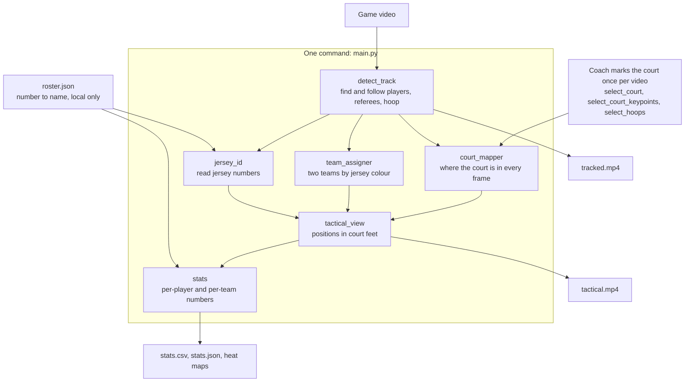

# basketball-tracker

Turns a basketball game video into coaching information: which players were
in the picture, which team they are on, their jersey numbers, where they were
on the court, and per-player numbers such as distance covered.
It is built to run on an ordinary laptop with no GPU (AMD Ryzen 5 4500U, 8 GB
RAM, WSL Ubuntu), so every design choice trades accuracy against CPU time.

**Status: stage 1 ("see the players") is written and works on a 20-second test
clip. It has not been run on a full game yet.** The ball is not tracked
reliably, so there are no ball stats (possession, passes, shots) of any kind.

Roadmap:

1. See the players: tracking, teams, jersey numbers, court positions, stats. **This is what exists.**
2. See the ball and events.
3. Store games and learn from corrections.
4. Training suggestions.

---

## How it fits together



The video and every result stay on the local SD card. `roster.json` stays in
the project folder on this computer and is ignored by git. Only the code and
this description are in git.

---

## The pipeline

One command runs six stages in this order. Each stage is also a script that
can be run on its own with `--video`.

| Stage | File | What it does | Main result |
|---|---|---|---|
| `detect` | `src/detect_track.py` | Finds players, referees and the hoop in every 3rd frame and follows each person with an ID number | `tracks.json`, `tracked.mp4` |
| `court` | `src/court_mapper.py` | Works out where the court is in every frame, from the landmarks you clicked | `court_frames.json` |
| `teams` | `src/team_assigner.py` | Splits the player IDs into two teams by jersey colour | `teams.json` |
| `jerseys` | `src/jersey_id.py` | Reads jersey numbers and lets the readings vote | `jerseys.json` |
| `tactical` | `src/tactical_view.py` | Player positions in court feet, and a top-down video | `positions.json`, `tactical.mp4` |
| `stats` | `src/stats.py` | Per-player and per-team numbers | `stats.json`, `stats.csv` |

The court stage needs you to mark the court once per video, with three small
browser pages: `src/select_court.py`, `src/select_court_keypoints.py` and
`src/select_hoops.py` (see "Mark the court" below). Shared pieces are in
`src/config.py` (paths and constants), `src/court_model.py` (the court's lines
in feet) and `src/click_tools.py` (helpers for the pages).

---

## Run it

```bash
cd ~/aicloudops/basketball-tracker
source ~/venvs/hoops-tracker/bin/activate
python src/main.py --video clips/test.mp4
```

- A stage is skipped when its results are already there and are newer than
  the files they were made from. After any stop (Ctrl+C, a crash, the laptop
  shutting down) run the same command again: finished stages are skipped and
  a half-done detection, jersey reading or court mapping carries on where it
  stopped.
- `--force` does every stage again. `--from teams` does that stage again
  (stage names as in the table above), and then every later stage that uses
  its results: after `teams` that is `tactical` and `stats`, but not the hours
  of jersey reading. If such a run is stopped, run it again without the option
  to carry on.
- Detection of a video that is already finished is never started again by
  accident: it takes `--force` or `--from detect`. `tracks.json` and
  `tracked.mp4` are only written when the end of the video is reached, so
  stopping a run early cannot replace finished results.
- If the court has not been marked for the video, detection, teams and jersey
  numbers run first. Then the program stops and prints the commands to run.
  You can also mark the court in a second terminal while detection is running.
- At the end it prints where the results are (also as Windows paths under
  `D:\hoops-tracker`), any stretches of the game with no court mapping, the
  stats table and any warnings.
- Everything it prints is also added to `data/<video>/run_log.txt`, so the
  summaries of a long run can still be read after the terminal has scrolled
  on or been closed.
- Keep the laptop awake and VS Code open during a long run. If WSL shuts
  down, the run stops; nothing saved is lost, and the same command continues it.
- Run one video at a time; the laptop does not have the memory for two. A
  second run on the same video is refused while the first is still going.

### If the SD card is not found

When a message says a folder cannot be reached, the SD card is not attached
to Ubuntu (this happens after Windows or WSL restarts). Attach it with:

```bash
sudo mount -t drvfs D: /mnt/d
```

To have it attached automatically from now on, run this once:

```bash
echo 'D: /mnt/d drvfs defaults 0 0' | sudo tee -a /etc/fstab
```

If a message says a file is damaged, or a video "could only be read up to"
some point, the card has spoiled the file. Delete a damaged data file and run
`main.py` again; copy a damaged video to the card again and run `main.py`
with `--force`.

### Mark the court (once per video)

The camera view moves, so the tool needs to know where the court is. Steps 1
to 3 need no player detection, so they can be done before or during the long
detection run. Each command prints an address like `http://127.0.0.1:7860`;
open it in the browser. The pages run only on this computer.

To do this while detection is running, open a second terminal (in VS Code:
menu Terminal, New Terminal) and switch the environment on there first:

```bash
cd ~/aicloudops/basketball-tracker
source ~/venvs/hoops-tracker/bin/activate
```

1. `python src/select_court.py --video clips/game1.mp4`
   Choose the court size (high school 84 x 50 ft is the default; type your own
   numbers for another court). Untick any reference picture that is blurred or
   does not show the court. Press "Save and close".
2. `python src/select_court_keypoints.py --video clips/game1.mp4`
   Pick a picture, choose a landmark from the list, click it in the picture,
   then click it again exactly in the enlarged picture. Use the basketball
   lines, not the lines of other sports. Do at least 4 landmarks at each end
   of the court the video shows, 10 to 14 in total, and include the two
   points where the half-court line crosses the centre circle. After 4 landmarks a green
   court is drawn: it should sit on the real lines in every picture. Press
   "Save and close".
3. `python src/select_hoops.py --video clips/game1.mp4` (optional for now;
   it is for shot detection later.) For each hoop, click the two ends of the rim.
4. Run `python src/main.py --video clips/game1.mp4` (again; if it is still
   running in the first terminal there is nothing to do, it goes on to the
   court stage by itself). After the court stage, open
   `outputs/game1/court_check.jpg`: the green court should sit on the real
   lines in all the small pictures. If the summary lists stretches with no
   court mapping (it is repeated at the very end of the run and kept in
   `run_log.txt`), add a reference picture with the command it prints and run
   `main.py` again.

If the camera was moved during the recording, or it is another game, do these
steps again for that video.

### Player names

Copy `roster.example.json` to `roster.json` and fill in jersey number and
name for each team. `roster.json` is ignored by git, so names never leave
this computer; everything works without the file. The stats show a name only
for a player whose team and number were read, and only when the numbers read
fit one roster team clearly better than the other (the roster does not say
which jersey colour a team wears). Jersey reading uses the roster too: when
both teams are filled in, a number that is on neither counts as half a vote.
After filling in the roster, run `main.py` with `--from jerseys` for that to
take effect.

---

## What comes out

Everything is written to the SD card, in folders named after the video
(`test` for `clips/test.mp4`).

| File | What it is |
|---|---|
| `outputs/<video>/tracked.mp4` | The game with a box and tracking ID on every player and referee |
| `outputs/<video>/tactical.mp4` | The game above a top-down court diagram, one dot per player in team colour with the jersey number |
| `data/<video>/stats.csv` | The per-player table; opens in Excel |
| `data/<video>/stats.json` | The same with every detail, plus team spacing minute by minute |
| `outputs/<video>/heatmap_<team>.png` | Where on the court each team's players were seen |
| `outputs/<video>/teams_sheet.jpg` | Check by eye: sample pictures of every ID grouped by team |
| `crops/<video>/track_<5-digit ID>.jpg` | Check by eye: what the jersey reader looked at and what it read |
| `outputs/<video>/court_check.jpg` | Check by eye: the green court drawn on 8 moments of the game |
| `outputs/<video>/court_views.jpg`, `court_calibration_check.jpg`, `hoops_check.jpg` | Check by eye: the court set-up |
| `data/<video>/tracks.json` | Every box in every frame looked at (players, referees, hoop, and unreliable ball boxes) |
| `data/<video>/teams.json`, `jerseys.json` | Team and jersey number of each tracking ID, with the votes behind them (the team is empty when it could not be told) |
| `data/<video>/court_setup.json`, `court_calibration.json`, `hoops.json`, `court_views/` | Your court set-up |
| `data/<video>/court_frames.json` | The court mapping of every frame looked at |
| `data/<video>/positions.json` | Every player's position in feet (x from the left baseline as the camera sees it, y from the near sideline) |
| `data/<video>/run_log.txt` | Everything `main.py` printed, run after run |

### Reading the stats

**Nothing here is "minutes played".** The camera follows the play and never
shows the whole court, so a player who is out of the picture is not counted.

| Column | Meaning |
|---|---|
| Seen | Time the player was seen on camera |
| On map | Time the player also had a position on the court (feet inside the picture) |
| Distance | Feet covered while on the map. Gaps are not filled in, and a step that would need more than 25 ft/s is left out as a tracking mistake |
| Speed | Distance divided by the time of the steps that were counted, in feet per second |
| Avg spot | Average position in court feet |
| Left / Mid / Right | Share of the on-map time in each third of the court, as the camera sees it |
| Paint | Share of the on-map time inside either lane |
| IDs | How many tracking IDs were joined into this player |

- One real player usually gets several tracking IDs. IDs with the same team
  and the same jersey number are joined into one player.
- An ID without a number is never guessed. It is counted as "unidentified"
  for its team, below the table (the longest few are named by tracking ID, as
  they are labelled in `tactical.mp4`), and has its own row in `stats.csv`
  after the numbered players.
- Spacing is the average distance between a team's players that are on the
  map at the same moment.

---

## What was measured

All of this is from one 20-second test clip (1920x1080, 200 frames looked
at), checked by eye against the pictures. The settings were tuned on that
same clip, so these are best-case numbers.

**The clip is mostly a stoppage, not live play.** Both teams are in the
picture together for only 7.5 of its 20 seconds, and two thirds of all the
movement measured is slower than 3 ft/s (walking pace). Players cross and hide
each other far more in live play, so expect more ID changes, more wrong or
missing positions and fewer numbers read in a real game. Before trusting a
full-game run, cut a second clip of 20 to 30 seconds of continuous half-court
play and repeat the by-eye checks on it.

| Step | Measured on the test clip |
|---|---|
| Detection and tracking | 5.8 players boxed per frame on average; 21 tracking IDs for about 10 real players; hoop found in 98% of frames |
| Teams | 16 of 21 IDs given a team, all 16 right; 5 left without a team (3 bystanders, 2 real players only ever seen cut off by the picture edge) |
| Jersey numbers | 11 of 21 IDs got a number, all 11 right by eye, none wrong; 1 more was readable by eye but not read. 1 of the 50 readings that counted was the number of a team-mate standing in front; it was outvoted |
| Court mapping | 200 of 200 frames mapped. At the end of the court that was marked, the drawn court was a median 1 pixel from the painted lines (2 pixels in the frame with the worst median). A later check by eye of two frames found the half-court line and centre circle drawn 10 to 22 pixels (0.25 to 0.5 ft) off; only one landmark was marked there. On 20 single frames taken from across a full game: median 2 pixels, 8 pixels at the 95th percentile |
| Positions | 78% of player boxes got a court position (909 of 1165); 19% had their feet below the picture; 2% were left out because the box had taken in a second player; 1% were outside the court. By eye the dots were within about 1 to 2 ft of the painted lines they stood on |
| Stats | 10 players identified, covering 85% of all the time players were seen; nobody "seen" for longer than the clip; average speeds from 0.9 to 5.2 ft/s |
| Joining IDs | Measured on an earlier version: a run that was killed half-way and resumed (so every player got a new ID) gave the same players after joining by team and number: time seen within 0.1 s, distance within 3 ft. A run stopped after the first second lost up to 1.1 s of a player's seen time, because a one-second ID is too short to get a number |
| Stopping and carrying on | With the real models: Ctrl+C while the model was loading changed nothing; Ctrl+C during detection kept the frames done, and the next run carried on from there; a second run started on the same video meanwhile was refused; Ctrl+C during jersey reading kept the IDs finished so far |
| Time | The latest full run took 11.5 minutes: detection 5 minutes (0.84 frames per second), court mapping 1.5 minutes, jersey reading 3 minutes (0.5 to 0.6 seconds per picture), the top-down video 1 minute. The run before it took 19 minutes with the machine short of memory and using swap (detection at 0.6 frames per second, 0.8 to 1.9 seconds per jersey picture). The first runs measured about 2 frames per second for detection and 0.3 to 0.4 seconds per jersey picture; no later run got there |
| Memory | One run through all six stages in one program peaked at 1.3 GB. After detection the memory in use fell from 1185 MB to 488 MB before the next stage started |

---

## Limitations

- **Not minutes played.** The camera follows the play; off-screen players are
  not counted. "Seen" and distance are lower bounds, and are not comparable
  between a player who is usually near the ball and one who is not.
- **No ball.** The ball is not tracked reliably (see the experiment below),
  so there is no possession, pass or shot information.
- **A full game has never been run.** A 52-minute game is about 31,000
  frames to look at. Extrapolated from the test clip at the speeds of the
  latest runs: detection 8 to 14 hours, jersey reading 10 hours or more, court
  mapping about 3 hours, the top-down video 2 to 3 hours. At the best speeds
  ever measured it would be 4 to 5 hours each for detection and jersey
  reading. Plan for a run of a day or two, and time a short clip first with
  nothing else open. Every long stage saves its progress and continues after
  a stop.
- **Jersey numbers.** Only about half of the IDs got a number on the test
  clip (11 of 21). A number can only be read when the player is large enough
  and facing toward or away from the camera. The reader was tuned on the test
  clip; expect some wrong numbers elsewhere. When another player stands in
  front, it is that player's number that gets read. A wrong number joins two
  different players; the stats flag a player who is "in two places at once".
- **Unidentified time.** 15% of the time players were seen on the test clip
  belongs to IDs with no number, and is not credited to any player. One real
  player can be hit hard: one player there was on camera for about 16 seconds
  under four tracking IDs, and the two IDs that got that number cover only 7
  of them. The longest unidentified IDs are named under the stats table so
  they can be looked up in `tactical.mp4`.
- **Court mapping.** The landmark clicks for the test clip are stand-ins made
  from measured line crossings, not clicked by a person, and clicking in a real
  browser has not been tried yet. A landmark clicked about 3 ft off was not
  flagged in a test, so the green overlay is the real check. Marking only one
  end of the court left the other end 2 to 5.5 ft off, depending on the test.
- **Positions.** A position is the bottom-centre of the player's box. When
  the legs are hidden behind another player, the dot is typically 4 to 8 ft
  off in depth. Players nearest the camera often have their feet below the
  picture and get no position (19% of boxes on the test clip).
- **The strip nearest the camera is empty.** On the test clip no position was
  nearer than 12.5 ft to the camera-side sideline, although players stood
  there: their feet were below the picture. So the near strip of every heat
  map is blank, and average spots and team spacing lean toward the far side.
- **Distance is smoothed.** Smoothing removes box shake, and with it 40% of
  the raw distance on the test clip; some real movement at sharp turns is
  rounded off too.
- **Distance is overstated for players standing in a group.** When one player
  stands behind another, the box sometimes grows to take in both, and the foot
  point jumps to the other player's feet and back. A box that is suddenly more
  than 20% taller than the same player's boxes around it gets no position (25
  of the 948 boxes with feet in view on the test clip; for one player who stood still this took 15 ft
  of movement that never happened off a 42 ft total). A merge that builds up
  slowly, or lasts longer than about 1.5 seconds, is not caught.
- **Two boxes on one player.** The detector sometimes draws a second box on a
  player who already has one (6 boxes on the test clip). Unless nearly all of
  it lies inside the first box it is kept, and counts for a moment as one more
  player of that team, a few feet away.
- **Only one team in the video.** The team step always splits the jersey
  colours into two groups. On cut-down copies of the test clip that showed one
  team only, the "second team" was 1 or 2 players of the first, or bystanders.
  Three simple checks printed a warning in every such case that was tried
  (it is repeated under the stats table), but they were tuned on one clip.
  On any short clip, check `teams_sheet.jpg`.
- **Left and right are the camera's.** The tool does not know which hoop a
  team attacks, or when the teams change ends.
- **Bystanders.** People standing within 3 ft of the court can be boxed as
  players. A bystander wearing a colour close to a team's can be put on that
  team, and counts in its spacing and heat map.
- **Tracking was tuned on one clip.** Referees are found in fewer than half
  of the frames and are not used for anything yet. Referee boxes also land on
  bystanders and on the background (a by-eye check of the test clip found 17
  of 96 that were not a referee), so a later stage must not use them without
  checking that the box is on the court.

---

## How it was built

The project was built in small steps, each one tested on a 20-second clip
before the next began. Where there was a real choice to make, the options were
tried and measured first.

1. **Set-up.** A CPU-only Python environment, with large files kept on an SD
   card (section 1 below).
2. **Choosing a detector.** A general-purpose model was compared with
   basketball-trained ones on the same clip (section 2).
3. **Testing the ball.** Two models and two picture sizes were tried, and every
   "ball" was checked by eye. Neither model was good enough, so ball tracking
   was left out of this stage (section 3).
4. **The moving camera.** The picture pans and zooms, so the court has to be
   found in every frame. Three approaches were prototyped and compared before
   one was built (section 4).
5. **The stages.** Detection was built and run first. Teams, jersey numbers
   and court mapping were then built side by side against one agreed set of
   result files, followed by the top-down view, the stats and `main.py`.
6. **Independent testing and review.** The finished pipeline was run from
   scratch by a tester who had not written it, then reviewed three ways (code
   correctness, accuracy against the pictures, and the laptop's limits). The
   fixes were followed by a second from-scratch run (section 5).
7. **Privacy guards.** Before anything was published, the repository was set
   up so that only code and text can be committed (section 6).

### 1. Environment (CPU only)

PyTorch CPU build, Ultralytics YOLO, Supervision, OpenCV, scikit-learn, EasyOCR
and Gradio, pinned in `requirements.txt`. ffmpeg comes from the
`imageio-ffmpeg` package, so nothing needs a system install.

### 2. Model comparison on real game footage

`experiments/compare_models.py` runs a model over a 20-second test clip
(1920x1080, 30 fps; the camera is fixed, but the exported picture pans and
zooms to follow the play) and reports what it finds.
Sixty frames were sampled per model.

| | Standard `yolov8n` | Basketball-trained `player_detector` | Basketball-trained `ball_detector_model` |
|---|---|---|---|
| Speed on this laptop | 4.5 frames/sec | 0.9 frames/sec | 0.9 frames/sec |
| Players: average confidence | 0.56 | 0.79 | 0.49 |
| Referee found | never (no such class) | 65% of frames | 47% of frames |
| Hoop found | never | 98% of frames | 77% of frames |
| Ball reported | never | 68% of frames | 82% of frames |

Findings:

- The basketball-trained player model is clearly better at players, referees
  and the hoop, but about five times slower. A full 52-minute game at every
  frame would take roughly 29 hours; sampling 10 frames per second brings that
  to about 10 hours.
- Ball detection is not reliable yet. The "ball reported" figures include false
  detections (for example a box on a player's legs while the referee held the
  ball), so they overstate the real hit rate.

The pipeline uses `player_detector` at 10 looks per second. In the pipeline
it first ran at 1.9 to 2.3 frames per second on a quiet machine, faster than
the 0.9 measured in this experiment; later runs measured 0.55 to 1.1.

The basketball-trained weights come from the MIT-licensed
[abdullahtarek/basketball_analysis](https://github.com/abdullahtarek/basketball_analysis)
project. They were trained on NBA broadcast footage, not gym footage. Both files
were checked with `picklescan` before being loaded.

### 3. Ball detection experiment

`experiments/ball_resolution_test.py` tests whether looking at the frame at
higher resolution helps find the ball, which is only a few pixels wide in
wide-angle footage. It takes 20 frames from the test clip, runs
`player_detector` at 640 and 1280 pixels, and saves a close-up of each top
"ball" candidate so every one can be checked by eye.

| `player_detector` | Normal (640) | High (1280) |
|---|---|---|
| Top candidate really was the ball | 3 of 20 frames | 3 of 20 frames |
| Top candidate was something else | 10 of 20 | 12 of 20 |
| Nothing reported | 7 of 20 | 5 of 20 |

The same test on the dedicated `ball_detector_model`:

| `ball_detector_model` | Normal (640) | High (1280) |
|---|---|---|
| Top candidate really was the ball | 2 of 20 frames | 2 of 20 frames |
| Top candidate was something else | 16 of 20 | 14 of 20 |
| Nothing reported | 2 of 20 | 4 of 20 |

Findings:

- Higher resolution did not help. The ball was found only when it was large
  and in the open (a dribble, or the referee holding it).
- Most false detections were players' elbows, forearms and lower legs, some at
  0.70-0.89 confidence, so a confidence threshold cannot separate them from the real ball.
- Conclusion: neither model can be relied on for the ball in this footage.
  The likely fix is fine-tuning on labelled frames from the team's own games.

### 4. Court mapping with a moving camera

Three approaches were prototyped on the test clip and on single frames taken
from across a full game:

| Approach | How it works | Result on the test clip |
|---|---|---|
| Reference views | A few reference pictures are marked once; every frame is matched to them by image features | 200 of 200 frames mapped |
| One panorama | The frames are stitched into one wide picture of the gym, which is marked once | 200 of 200 frames mapped |
| Court lines | The painted lines are found in every frame and fitted to a court model, with no reference pictures | 200 of 200 frames mapped |

The three were calibrated independently and still put the same 948 player
foot points within a foot of each other (median difference 0.09 to 0.19 ft,
largest 0.71 ft), so accuracy did not decide the choice. The pipeline uses
reference views with one court calibration shared by all of them: it needed
the least gym-specific tuning, and the coach marks the court once per video.
The court-lines prototype was kept as an independent check when testing.

### 5. Testing and review

- An independent run of the whole pipeline from a clean start, checking every
  output file and looking at frames from both videos.
- Three separate reviews found 36 problems: 1 high, 13 medium and 22 low. The
  high one was that stopping a repeat detection early could replace finished
  results with an empty file.
- The 14 high and medium findings were each checked by a second reviewer who
  tried to disprove them. All 14 held, were reproduced, and were fixed, along
  with most of the low ones. What could not be fixed with a small change is
  listed under "Limitations".
- A final from-scratch run passed: the six stages ran with one command, the
  result files were identical to the previous run, and the by-eye checks
  matched the figures in "What was measured".

### 6. Privacy guards

The players in the footage are minors, so no footage, pictures, results or
names may reach GitHub.

- `.gitignore` is an allow-list: everything is ignored except Python code,
  Markdown, `requirements.txt`, the guard scripts and the blank roster template.
- `.githooks/pre-commit` refuses a commit that contains anything else, any
  binary file, a roster template with names typed into it, or a notebook that
  still has any saved output.
- `.githooks/pre-push` checks every file in the whole history being pushed in
  the same way, because deleting a file later does not remove it from history.
- The guards were tested against 14 ways a picture, a result file or a name
  could slip in. They work only where they are switched on (see "Reinstall
  from scratch"), and they do not cover uploads made through the GitHub website.

---

## What is in the repo

```
src/                  the pipeline (main.py runs it all)
experiments/          one-off test scripts behind the two experiments above
roster.example.json   blank template: jersey number -> player name
requirements.txt
.githooks/            guards that keep pictures, video, results and names out of git
clips/ models/ outputs/ crops/ data/   links to the SD card, not in git
```

The five data folders are links to `/mnt/d/hoops-tracker` on an SD card (`D:`),
so game videos, model weights and outputs never take space on `C:` and are never
committed. The SD card must be plugged in and mounted at `/mnt/d` (see "If the
SD card is not found" above).
No game footage, images of players, results or player names are stored in this
repository.

---

## Start working (every new terminal)

```bash
cd ~/aicloudops/basketball-tracker
source ~/venvs/hoops-tracker/bin/activate
```

To leave the environment: `deactivate`

## Reinstall from scratch

```bash
python3 -m venv ~/venvs/hoops-tracker
source ~/venvs/hoops-tracker/bin/activate
pip install --no-cache-dir torch torchvision --index-url https://download.pytorch.org/whl/cpu
pip install --no-cache-dir -r requirements.txt
```

`--no-cache-dir` stops pip keeping a download cache on `C:`.

On a fresh copy of the project, also make the five links to the SD card and
switch on the guards that keep pictures, video, results and names out of git:

```bash
cd ~/aicloudops/basketball-tracker
for name in clips models data outputs crops; do
    mkdir -p /mnt/d/hoops-tracker/$name
    ln -s /mnt/d/hoops-tracker/$name $name
done
cp .githooks/pre-commit .githooks/pre-push .git/hooks/
```

The guards are copied into `.git/hooks` so they keep working whichever
version of the project is checked out. Copy them again if they are changed.

Without the links the programs stop with a message; they never create these
folders inside the project.

The number reader (EasyOCR) downloads its two model files (about 100 MB) to
`models/easyocr` on the SD card the first time jersey reading runs.
